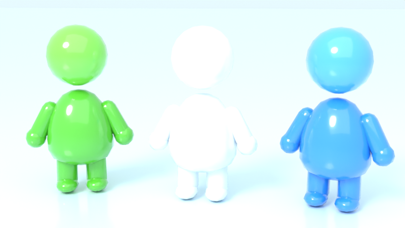
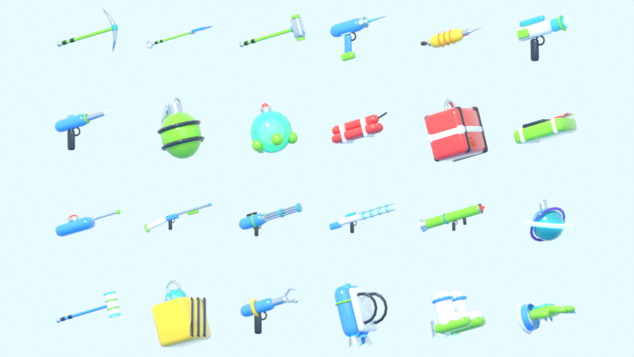

# Cubestruction

A cross-platform multiplayer voxel-demolition game in a glossy **Frutiger Aero** style. You play as a little
glass-plastic *Buddy*. Climb a giant pixel cube, mine it with 24 tools, blow it up, get blown up, and get paid.
The match ends the moment the **last pixel** is cleared.

Players on **Meta Quest (VR)**, **PC**, **Mac** and **Mobile** can play together over Unity Relay.

| Mode | Who | Goal |
|---|---|---|
| **Mining** (co-op, 1–6) | everyone | Clear every voxel. Inner layers pay more and are harder. The MVP is whoever cleared the most. |
| **God Siege** (1 v 1+) | VR = **God**, PC/Mac/Mobile = **Commander** | The Commander sends ever-stronger waves of units (Age of War style) to destroy the cube's Core. The God defends for 15 minutes with divine skills, including grabbing and throwing units like ragdolls. |




---

## Getting it running

**Requirements:** Unity **6000.0 LTS** (tested target 6000.0.32f1) with Android Build Support (+ OpenJDK/SDK/NDK),
plus Mac/iOS/Windows modules as needed. Blender is optional: the generated models are already committed.

1. Open the folder in Unity Hub. Packages resolve from `Packages/manifest.json` (Netcode for GameObjects 2,
   Multiplayer Services, OpenXR + Meta OpenXR, Input System, URP).
2. When asked to enable the new Input System backend, click **Yes** (the editor restarts).
3. Menu **Cubestruction ▸ Build Everything**. This generates the URP pipeline, materials, every network prefab,
   tool visuals, and the scene `Assets/Cubestruction/Scenes/Cubestruction.unity`. It also sets the Android/Quest
   player settings. Re-run it any time; it overwrites only `Assets/Cubestruction/Generated` and `Resources/ToolVisuals`.
4. **Online play (Relay):** *Edit ▸ Project Settings ▸ Services*, link a Unity Cloud project (free tier).
   Relay works without any other setup. LAN/direct-IP play needs no services at all.
5. **VR:** *Project Settings ▸ XR Plug-in Management*
   - Android tab: tick **OpenXR**, then under OpenXR add **Meta Quest Support** and the **Oculus Touch Controller Profile**.
   - Windows tab (PC VR / Link): tick **OpenXR** and add the **Oculus Touch** + **Valve Index** profiles.
   - Set *Render Mode* to **Single Pass Instanced** (the shaders support it).
6. Press **Play** in the editor for a desktop client, or *File ▸ Build And Run*:
   - **Quest:** Android target, ASTC textures. The cube is 40³ (64k voxels), which runs on a Quest 2 host.
   - **PC/Mac:** Standalone target. Pass `-novr` to force flat mode with a headset connected.
   - **Mobile:** Android/iOS target. Touch controls appear automatically (`-mobileui` forces them on desktop).

> These sources were written outside the Unity editor, so the first open may surface a few compile errors from API
> drift between package versions. They should be small, mechanical fixes. Check the Console after the package import.

## Controls

**VR (Quest Touch):**

| Input | Action |
|---|---|
| Grip | Climb: grab **any** voxel or prop and pull. Release mid-pull to fling yourself. |
| Trigger | Use the tool in that hand. Swing melee tools for real; hold drills and beams on target. To throw: squeeze, swing, release. |
| A / X | Cycle the tool in that hand. The left hand can be empty, keeping it free for climbing. |
| B / Y | Shop / menu (laser pointer, trigger to click) |
| Left stick | Move: Smooth, Teleport arc, or ArmSwing (hold both grips and swing your arms), set in Settings |
| Right stick | Snap or smooth turn; click to jump |

Two-handed tools (all guns and the Thumper jackhammer) only fire while your off-hand supports the tool, and they aim along both hands.

**PC/Mac:** WASD move · Mouse look · Space jump (double jump with Hop Boots) · **hold E to spider-climb** any surface you face ·
LMB use tool · RMB jetpack · 1–9 / wheel hotbar · Tab shop · Shift sprint. Gamepads also work.

**Mobile:** left-side joystick · right-side drag to look · Jump, Use (hold), Climb (hold), Sprint, Shop buttons.

**God (VR, Siege):** you are 8× scale. Grip a unit to pick it up and throw it with your real arm (it ragdolls, and impact damage scales with speed).
Slap units with fast hands. Left stick left/right picks a skill; right trigger casts where you point.

**Commander (Siege):** WASD/drag to pan, wheel/pinch to zoom, Q/E rotate. Unit buttons at the bottom (hotkeys 1–6), pick one of 3 portals.

## Gameplay rules

- **Layers** by depth: Crust → Stone → Crystal → Magma → Core. Each is worth more and has more HP.
  A tool below a layer's tier deals only 35% damage per tier of difference, so better tools unlock the core.
- **Sand physics:** any voxel left with ≤1 neighbour crumbles. Any chunk disconnected from the base collapses
  into falling sand. You get paid for those too.
- **Explosives ragdoll you.** Anything with knockback ≥ 9 m/s (grenades upward) launches you as a ragdoll,
  including your own explosives. There's a comfort toggle (*Allow ragdoll*) for VR players who get motion sick;
  with it off you still take knockback.
- **Movement options:** climbing (everyone), Gecko Gloves (2× climb stamina, 40% faster), Zip Tether grapple,
  Hop Boots (double jump/dash), Cloud Pack jetpack, rocket-jumping.
- **Co-op scaling:** voxel HP × players^0.5 and value × players^0.7 keep matches long and the shop reachable for everyone.

### The 24 tools

| Tool | Price | Type | Notes |
|---|---:|---|---|
| Bubble Pick | free | Melee | Starter |
| Aqua Spade | 120 | Melee | Wide, crust-only |
| Gecko Gloves | 300 | Movement | Passive |
| Fizz Grenade | 200/5 | Throwable | Ragdolls you |
| Gel Sledge | 500 | Melee | Stone |
| Goo Bomb | 450/5 | Throwable | Sticks |
| Zip Tether | 1,000 | Movement | Grapple |
| Swirl Drill | 1,500 | Melee (hold) | Crystal |
| Pop Stick | 700/4 | Throwable | |
| Spray Blaster | 1,800 | Gun (2H) | 8 pellets |
| Sky Beam | 2,500 | Beam | Ranged mining |
| Hop Boots | 2,500 | Movement | Double jump |
| Fizzy Barrel (TNT) | 1,200/3 | Placed | 5 s fuse |
| Thumper | 4,000 | Melee (2H) | Magma |
| Pixel Charge (C4) | 3,000/3 | Placed | Remote via Clicker |
| Cloud Pack | 7,000 | Movement | Jetpack |
| Bubble Gatling | 7,000 | Gun (2H) | Spin-up |
| Aurora Cutter | 9,000 | Beam | Magma |
| Bloop Launcher | 10,000 | Gun (2H) | Rocket-jumps |
| Chime Hammer | 12,000 | Melee | Shockwave |
| Glass Lance | 15,000 | Gun (2H) | Pierces 22 cells |
| Vortex Orb | 6,000/2 | Throwable | Pulls you in |
| Sunburst Crate | 40,000 | Placed | 10 s countdown, 12-cell radius |

Exact numbers live in `Assets/Cubestruction/Resources/Balance/tools.json`.

## Balance

All balance data lives in three JSON files under `Assets/Cubestruction/Resources/Balance/` (`layers.json`, `tools.json`, `siege.json`).
The game **and** a Python simulator read these same files:

```bash
pip install numpy
python3 Tools/balance_sim.py table     # $/s of every tool on every layer
python3 Tools/balance_sim.py mining    # simulated 1/2/4-player matches on a real 40³ grid
python3 Tools/balance_sim.py siege     # God win-rate vs skill
python3 Tools/tune_tools.py            # re-fit tool damage to the target $/s curve
```

Current results:

| Scenario | Result |
|---|---|
| Mining, solo | cleared in **~27 min** |
| Mining, 2 players | **~18 min** |
| Mining, 4 players | **~13 min** |
| Siege, novice God (skill 0.3–0.45) | loses |
| Siege, competent God (0.6) | wins **~70%** |
| Siege, expert God (0.75+) | wins **~95%** |

Each tool's damage was fitted so its $/s on its intended layer rises with price. No tool is strictly dominated, and
single-hit tools always one-shot a voxel of their target layer at the centre of the hit, so they feel punchy.

## Project layout

```
Assets/Cubestruction/
  Scripts/Core      Balance loader, settings, MatchManager, scene decor
  Scripts/Voxels    VoxelGrid (rules), VoxelCube (network), VoxelChunk (meshing), VoxelDebris (sand)
  Scripts/Player    PlayerAvatar, PlayerMotor, VRRig, FlatRig, AvatarVisual, PlayerRagdoll
  Scripts/Tools     ToolController, ExplosiveProjectile + Explosion, FxHub, ToolVisuals
  Scripts/Siege     SiegeDirector, EnemyUnit, GodController, CommanderController
  Scripts/UI        Aero theme, HUD + hotbar, shop, menus, mobile controls, VR pointer
  Scripts/Net       NetBootstrap (Relay / LAN), OwnerNetworkTransform
  Scripts/Editor    CubestructionProjectBuilder (menu: Cubestruction ▸ Build Everything)
  Shaders           AeroGloss (glossy plastic/glass), UnlitTransparent (beams, bubbles, vignette)
  Models            Blender-generated FBX: Buddy, 24 tools, 6 units, environment
  Resources/Balance layers.json, tools.json, siege.json
Blender/            Model generator scripts (python3 Blender/build_all.py with `pip install bpy`)
Tools/              balance_sim.py, tune_tools.py, make_sfx.py
```

## Networking model

- **Netcode for GameObjects 2** with **Unity Relay** (join codes) or direct IP. Host-authoritative.
- The voxel cube is server-authoritative: clients send compact, rate-limited, range-checked tool RPCs.
  The server applies damage and broadcasts destroyed cell indices. Late joiners get a bit-packed snapshot (8 KB).
- Player movement is owner-authoritative (`OwnerNetworkTransform`) so VR head and hands have zero latency.
- Explosions are simulated on the server. Knockback is sent to each affected player's owner, who ragdolls locally,
  and every client builds the same ragdoll for display.
